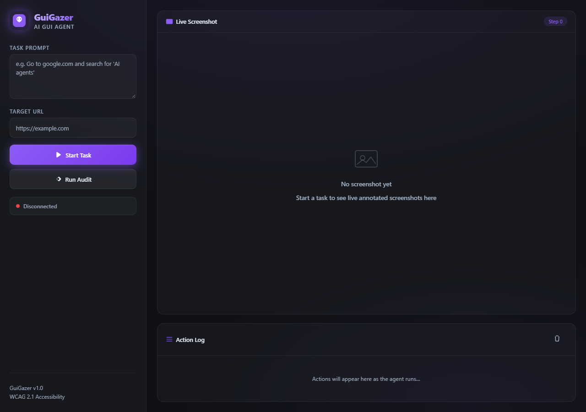
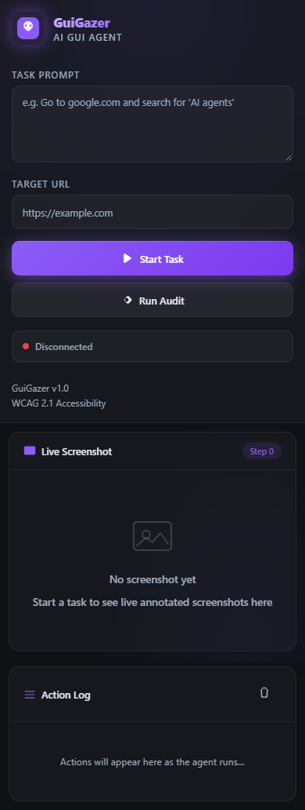
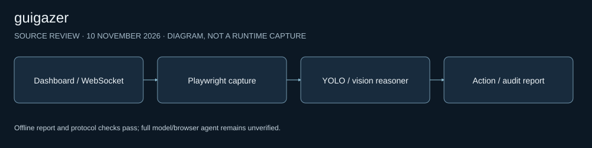
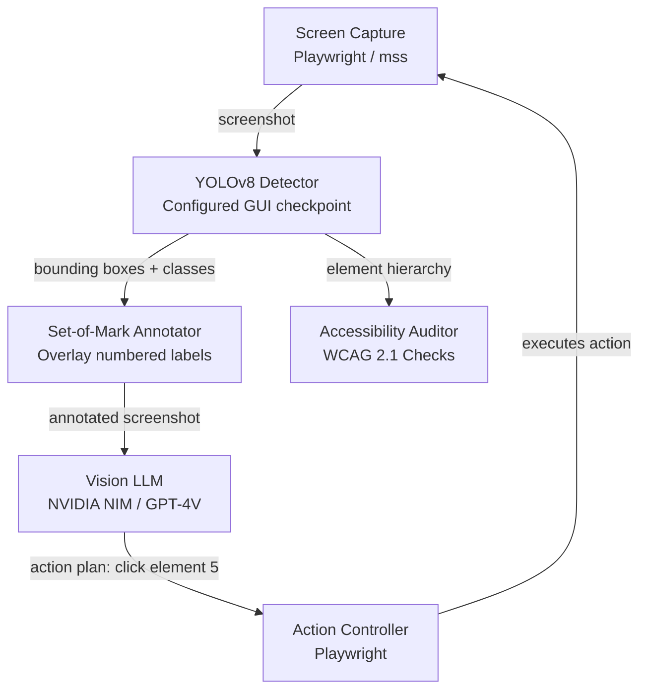
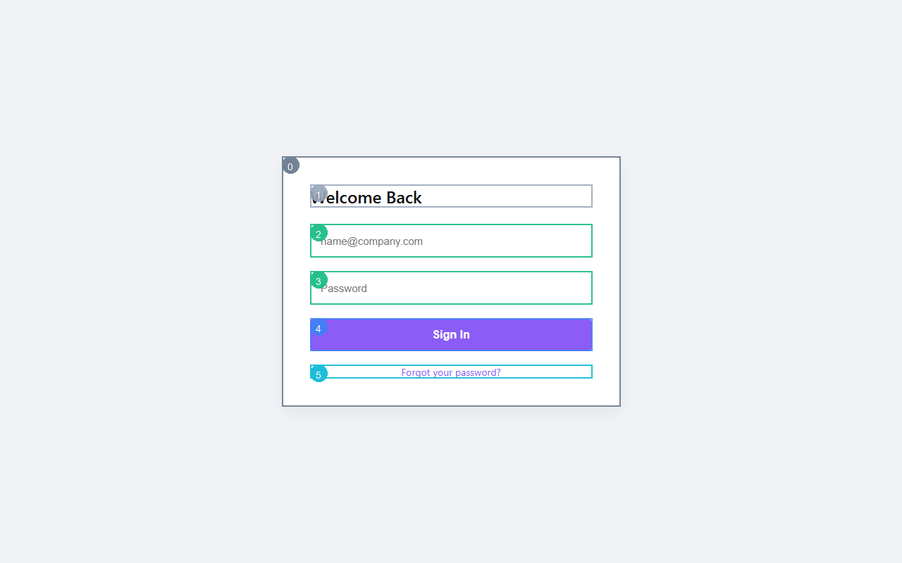

<div align="center">
  
# 👁️ GuiGazer

**A browser automation prototype combining YOLOv8 visual grounding, Playwright and remote vision-model reasoning.**

[](https://www.python.org)
[](https://fastapi.tiangolo.com)
[](https://ultralytics.com)
[](https://playwright.dev)



</div>

## Verified scope — 10 November 2026

The source implements a FastAPI/WebSocket dashboard, Playwright action loop,
YOLO detector wrapper and screenshot-based accessibility heuristics. Vision
reasoning calls NVIDIA/OpenAI services; the complete system is not on-device.
Fine-tuned GUI weights and detection accuracy were not validated in this review.
When those weights are absent, `detector/model.py` loads generic COCO YOLO weights
but maps low class IDs to UI labels; that fallback does not establish GUI accuracy.

Offline fixes cover escaped page-derived labels/classes in HTML reports,
an existing JavaScript parse error, and dashboard handling of the server's
`screenshot_b64` / `report_html` fields. Regression checks:

```sh
python -m unittest discover -s tests -v
node --test tests/dashboard-contract.test.js
node --check frontend/app.js
```

The three Python tests exercise report escaping and real agent/audit code with
synthetic Detection objects and images. Provider/executor imports are stubbed;
no browser is launched. The Node test checks the dashboard protocol with a minimal
DOM/WebSocket stub. Detection objects are now converted to audit dictionaries
with stable IDs, and step callbacks carry the annotated image for server encoding.
These are offline contract checks, not an end-to-end browser/model success claim.
The visual checks remain heuristics; their score is not a WCAG certification.

### Local UI check



The desktop image above and mobile image here are actual local HTML/CSS/JS
renders in isolated Edge at 1280×900 and 390×844. WebSocket, model and executor
boundaries were disabled. They show the disconnected state, not a completed
agent task. Keyboard focus, 44px actions, mobile viewer sizing and horizontal
bounds passed the offline browser checks. External font/script tags were removed
from the dashboard; no third-party asset is needed for this empty state.



The diagram is source-derived. `screenshots/audit.png` is an inherited
project asset, not new verification evidence. No weights, training dataset or
large model was downloaded. To validate the live path, provide known GUI-trained weights, then run against
an owned local fixture page before enabling a vision provider.


## 🤔 What It Does

GuiGazer captures browser pages through Playwright, attempts to detect interactive UI elements, and asks a remote vision model what to click or type next.

By combining **Computer Vision (YOLOv8)** for precise UI element detection with the reasoning capabilities of **Vision Language Models (GPT-4V / NVIDIA NIM)**, it parses unstructured interfaces into actionable steps. 

It can be used to:
1. **Automate Web/Desktop Tasks:** Tell it "Search for Python tutorials" and it will navigate, type, and click autonomously.
2. **Audit Accessibility:** Automatically evaluate web pages for WCAG compliance (contrast ratios, minimum touch targets, missing labels).

---

## 🏗️ Architecture & How It Works

GuiGazer uses a hybrid perception and reasoning pipeline:



1. **Capture:** Playwright takes a full-page screenshot of the target application.
2. **Detect:** YOLOv8 with a configured GUI-trained checkpoint identifies 12 distinct classes of UI elements (buttons, inputs, dropdowns, etc.).
3. **Annotate:** The system draws numbered Set-of-Mark (SoM) bounding boxes over the image so the LLM doesn't have to guess coordinates.
4. **Reason:** The Vision LLM receives the annotated image and user prompt, and decides which numbered element ID to interact with.
5. **Act:** The controller translates the element ID back to `(x, y)` coordinates and executes the click/type action.



---

## ⚡ How To Use (1-Click Quickstart)

1. **Clone & Setup:**
   ```bash
   pip install -r requirements.txt
   playwright install chromium
   ```

2. **Configure API Key:**
   Rename `.env.example` to `.env` and add your NVIDIA API Key (or OpenAI key).
   ```env
   NVIDIA_API_KEY=nvapi-your-key-here
   ```

3. **Launch the Dashboard:**
   Run the `start.bat` file (or `python main.py` directly).
   Open [http://localhost:8001](http://localhost:8001) in your browser!

4. **Run a Task:**
   - Type a task like "Search for AI tutorials" in the prompt box.
   - Watch the agent annotate the screen and execute the steps live!

---

## 📊 Training the Detector

To improve detection accuracy on your own UI components, you can fine-tune the YOLOv8 model:

```bash
# Generate synthetic dataset and train for 50 epochs
python -m detector.train --epochs 50
```

The best weights are automatically saved to `detector/checkpoints/guigazer_yolov8n.pt`.

## 🛡️ License
MIT License
